<p align="center">
  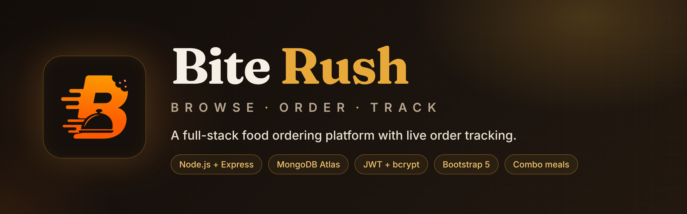
</p>

<p align="center">
  <b>A full-stack, production-deployed online food ordering platform — browse a live menu, build a cart,<br>
  checkout with server-validated pricing, and track your order in real time.</b>
</p>

<p align="center">
  <a href="https://bite-rush-frontend.onrender.com"></a>
  <a href="https://bite-rush-api.onrender.com/api/health"></a>
  <a href="https://github.com/Ajitabhjha13/bite-rush/actions/workflows/ci.yml"></a>
</p>

<p align="center">
  
  
  
  
  
  
</p>

<br>

<p align="center">
  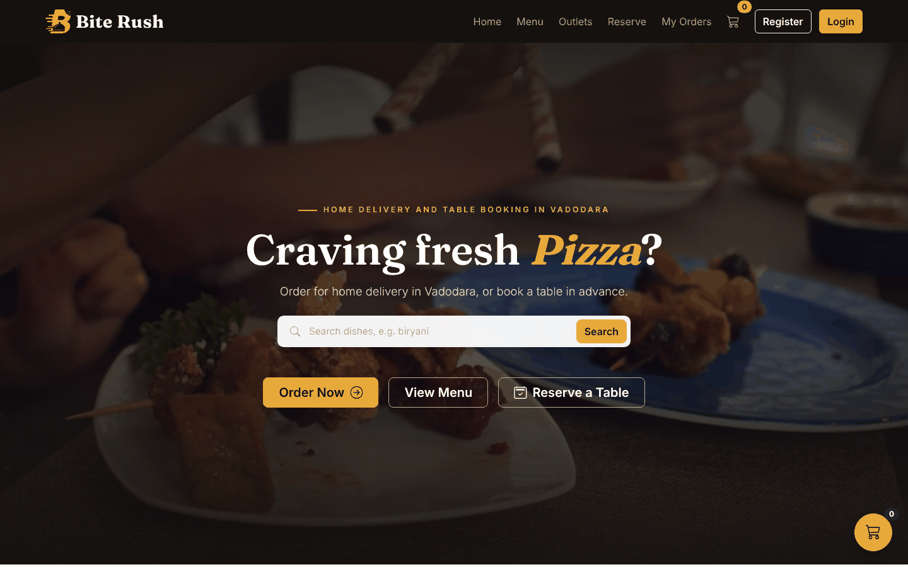
</p>

<p align="center"><sub>Screenshots use demo orders and fictional customers.</sub></p>

> Note: hosted on Render's free tier — the backend may take 30–50 seconds to "wake up" if it hasn't been used recently.

---

## 📑 Contents

[Why I built it](#-why-i-built-it) · [Highlights](#-highlights) · [Screenshots](#-screenshots) · [Architecture](#️-architecture) · [Engineering decisions](#-engineering-decisions) · [Data Model](#-data-model) · [Security](#️-security) · [Tech Stack](#️-tech-stack) · [Project Structure](#-project-structure) · [Getting Started](#-getting-started-local-development) · [API Reference](#-api-reference) · [Roadmap](#️-roadmap)

---

## 💡 Why I built it

Every food-ordering project I'd seen followed the same shape: a menu, a cart, an order. I wanted to build something that actually felt like it could run a real outlet — not just a CRUD demo with a cart bolted on.

So Bite Rush became an exercise in building things **the way a production app would need them**, even for a solo college project: prices are recalculated and validated on the server at checkout, not trusted from the browser; every destructive or privileged action checks ownership and role server-side, not just hidden in the UI; and the database schema is normalized so a menu price change can never silently rewrite the total of an order someone already paid for.

**I kept iterating on it long after the "minimum" feature set was done** — adding item customization, combo bundles, order cancellation — because the goal was never to finish a checklist, it was to build something that behaves correctly under real use.

---

## ✨ Highlights

| 🛒 Full ordering flow<br>Category-filtered **live menu**, a persistent **cart** (localStorage, survives refresh), **quantity steppers** right on the menu card, and a full **checkout** flow with order confirmation. | 🌶️ Per-dish customization<br>Items can be marked with a **spice level picker** (Mild / Medium / Hot) in a detail modal — opt-in per dish, validated server-side so only dishes that support it can carry a spice choice into an order. |
| --- | --- |
| 🍱 **Combo meals**<br>Admin-built bundles of existing menu items at a discounted price, with the **savings auto-computed** from the live prices of the items inside — never a stale, hand-typed number. | 📦 **Order lifecycle**<br>Received → Preparing → Ready → Delivered, with a live **status tracker**. Customers can **cancel** their own order while it's still queued, and **reorder** a past order in one click. |
| 🔐 **Server-validated pricing**<br>Every order total is recalculated from the database at checkout — the price a client sends is never trusted, closing the most common e-commerce tampering vector. | 🛡️ **Role-based admin dashboard**<br>A separate, protected dashboard for menu CRUD, live incoming orders (auto-refreshing), and combo management — completely inaccessible to non-admin accounts, enforced on the API itself. |
| 🪑 **Table booking with deposits**<br>Day-ahead reservations (5 slots, 10 tables, a separate online-only table pool). A seat is **held for 2 minutes** while the customer pays a ₹100 deposit via **Razorpay (test mode)**; double-booking is prevented at the **database level** with partial unique indexes, and a **tiered refund** (100% / 50% / 0%) applies on cancellation. | 🗓️ **Admin reservations grid**<br>Table × time-slot view for any date, with customer details, **Seated / No-show** check-in, restaurant-side **cancel with a full refund**, a retry button for failed refunds, and per-table **online / walk-in** switches. |
| 🖼️ **Self-hosted images**<br>Dish photos live in the project's own `images/` folder, not hot-linked from a third party — so the menu never breaks if an external image host changes or removes a file. | ✅ **Defensive input validation**<br>Every write endpoint runs through `express-validator` server-side — registration, login, menu changes, and order placement all reject malformed input before it ever reaches the database. |

---

## 🎬 Demo

<p align="center">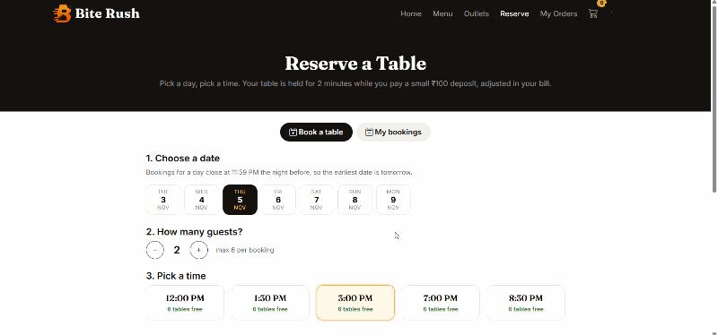</p>
<p align="center"><sub>Recorded against a local test setup with a stubbed payment popup and fictional customers.</sub></p>

---

## 📸 Screenshots

| Menu — search, sort, categories, prep time, spice & veg markers | Combo meals — "Save ₹X" computed from live prices |
|---|---|
| 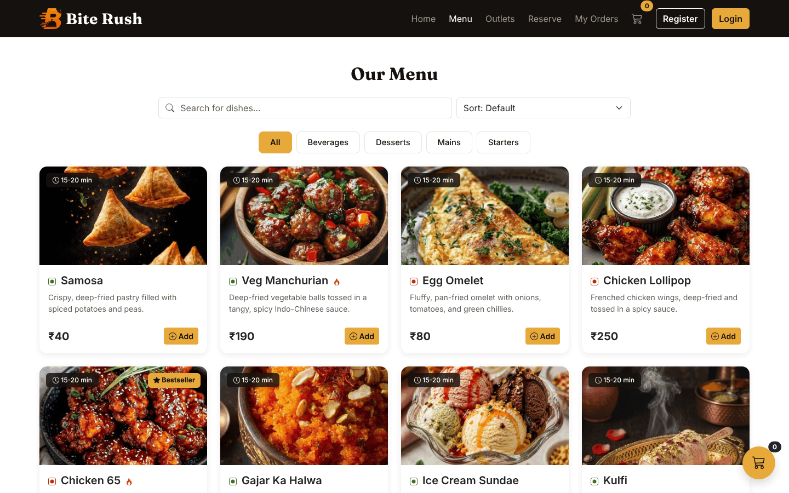 | 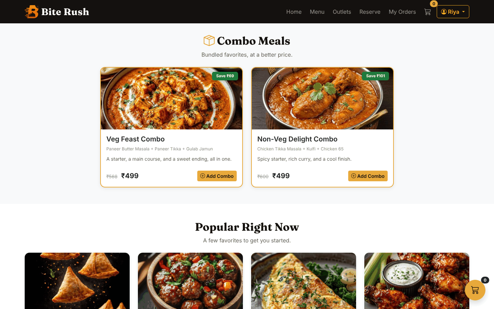 |

| Cart — regular items, a combo and a spice level | Order history — live status tracker and one-click reorder |
|---|---|
| 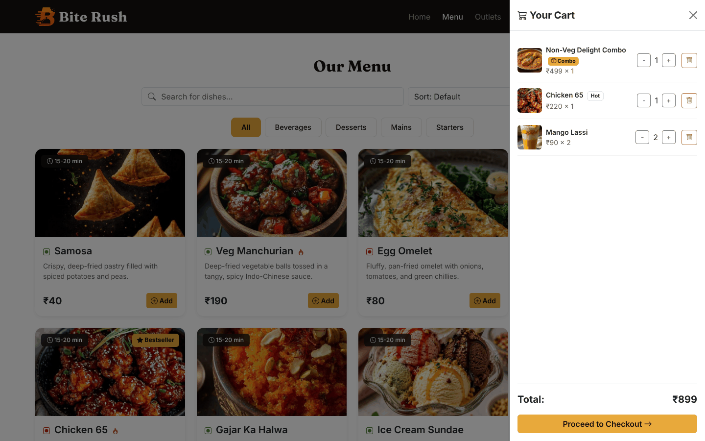 | 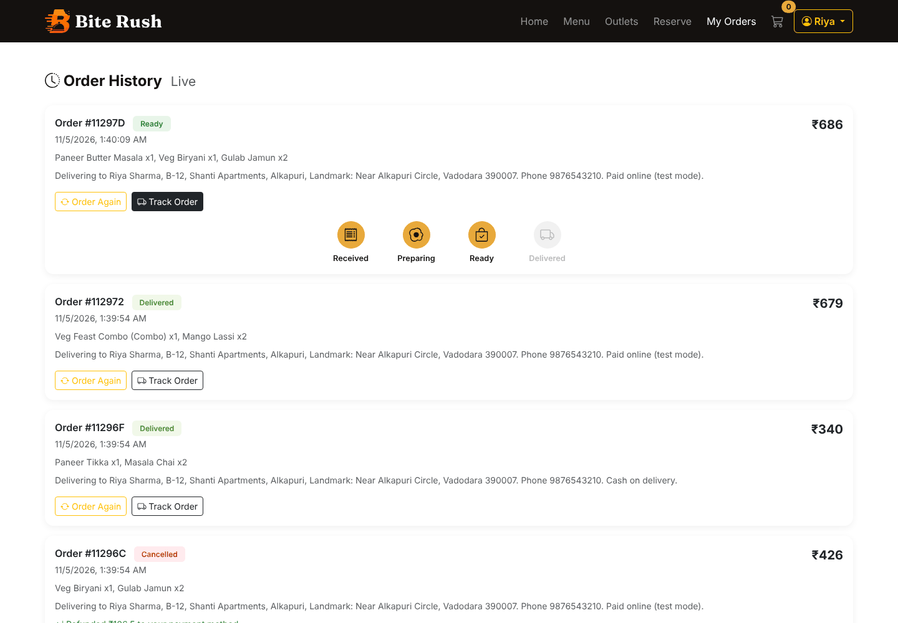 |

| Admin — live incoming orders (auto-refresh every 30s) | Admin — menu management |
|---|---|
| 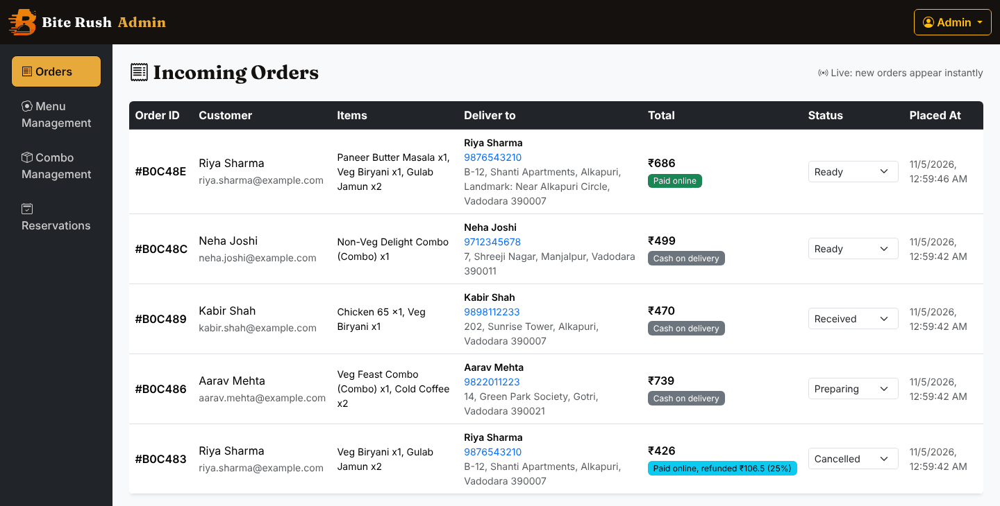 | 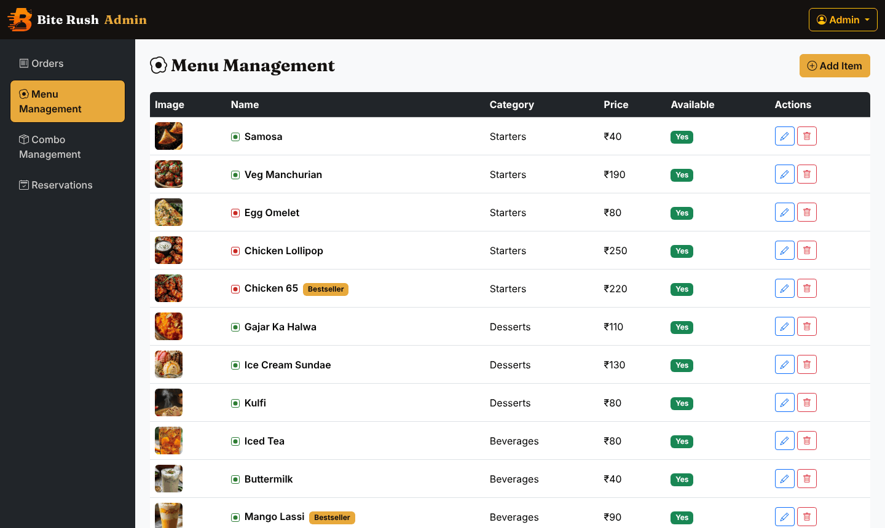 |

<p align="center"><b>Mobile</b> — the same flow on a phone: home, menu, cart and order tracking</p>
<p align="center">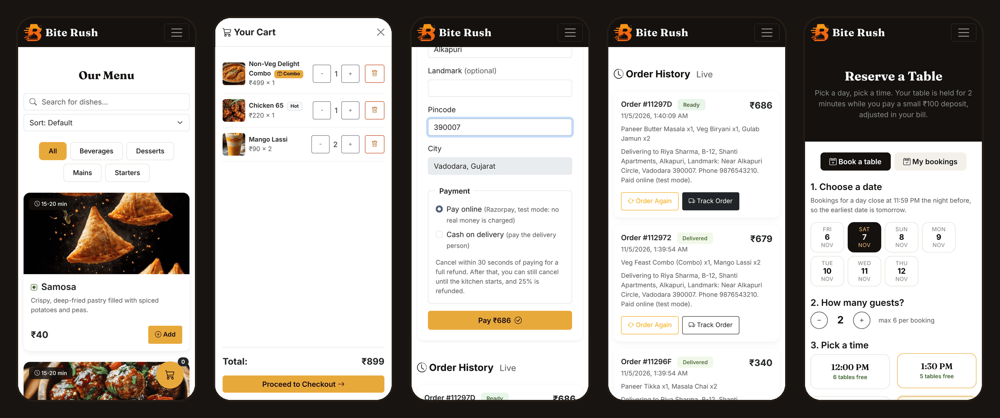</p>

---

## 🏗️ Architecture

Bite Rush follows a clean, fully decoupled 3-tier architecture — a static frontend, a stateless REST API, and a managed cloud database — talking entirely over JSON + JWT.

<p align="center">
  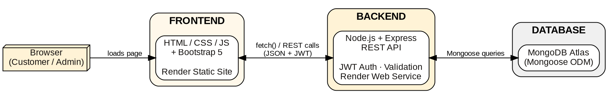
</p>

```
frontend/            → Static HTML/CSS/JS client (Render Static Site)
  ├── index.html, menu.html, outlets.html, order.html, admin.html, login.html, register.html
  ├── css/style.css   → Design tokens, hero/menu/admin/auth styling
  └── js/             → One concern per file (cart, auth, menu, order, admin, combo-aware checkout)

backend/
  ├── config/         → Database connection
  ├── models/         → Mongoose schemas (User, Category, MenuItem, Combo, Order, OrderItem)
  ├── controllers/     → Business logic per module
  ├── routes/          → Express route definitions
  ├── middleware/       → JWT auth, role-based access control, validation error handling
  ├── validators/       → express-validator rule sets per module
  └── server.js         → App entry point
```

### Data Model

<p align="center">
  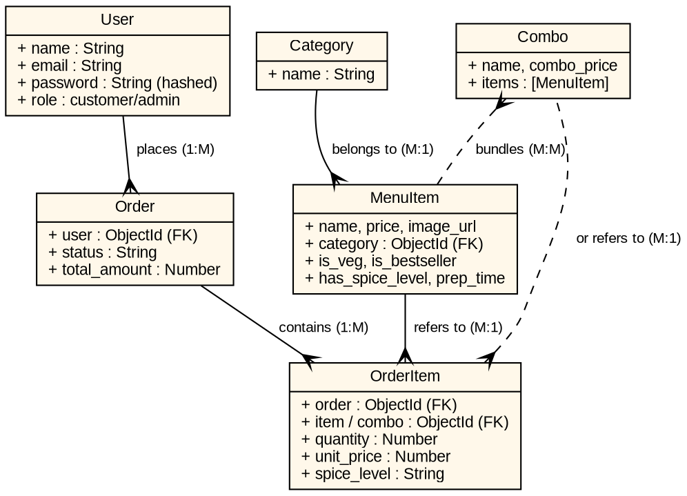
</p>

- **User** → places many **Orders**
- **Order** → contains many **OrderItems**
- **OrderItem** → refers to **either** a `MenuItem` **or** a `Combo` (never both), and snapshots `unit_price` + an optional `spice_level` at the moment of purchase — so a later menu price change, or deleting a combo, can never alter a historical order's total
- **MenuItem** → belongs to a **Category**, optionally flagged `has_spice_level`
- **Combo** → bundles multiple **MenuItems**; its "you save ₹X" badge is computed live from their current prices, never hand-entered

---

## 🧠 Engineering decisions

The choices below are the ones that were not obvious, and why I made them.

**Double-booking is prevented by the database, not by application code.**
A check-then-insert in Node has a race: two customers can both see a free table. Instead, reservations carry *partial unique indexes* (one active booking per table, date and slot), so the second concurrent insert fails at the database. Dates and slots are evaluated in IST, so "today" means the same thing for the customer and the server.

**A held seat expires on its own.**
A seat is held for 2 minutes while the customer pays. An expired hold stops counting as taken immediately, so abandoned checkouts never block a table, and if a payment still arrives after the hold expired, the server tries to re-take that seat in one atomic update; if someone else has it by then, the payment is refunded in full instead of double-booking.

**The server decides the money; the client only displays it.**
Order totals are recalculated from the database. The booking deposit comes from server configuration. The refund preview in the browser is only a preview; the server computes the real refund from the current time (100% at 6h or more, 50% at 2h or more, otherwise 0, and always 100% when the restaurant cancels).

**One code path confirms a payment, whoever tells us first.**
Razorpay can reach us twice: the browser callback and a signed webhook. Both call the same `applyCapturedPayment` function, so they cannot disagree. The webhook signature is checked against the *raw* request body (the webhook route is mounted before `express.json()`), and each event id is stored so a retry is a no-op.

**A refund can only be issued once.**
A refund is *claimed* with one atomic update (`refund_status` from `none` or `failed` to `processing`) before the Razorpay call. If two admins click at the same time, or a retry races the first attempt, only one wins. A failed refund is kept as `failed`, shown in the admin grid and can be retried.

**Rate limits key on the real client, not on a shared proxy address.**
Behind Render and Cloudflare, `req.ip` can be a proxy. The limiter prefers the edge's client-IP header and falls back to `req.ip`; IPv6 addresses are grouped by /56 so one user cannot dodge a limit by rotating addresses. Booking limits are per user, so people on the same Wi-Fi do not share a bucket. Webhooks are exempt, because blocking Razorpay would lose payments.

**Lists are paginated on the server, and without N+1 queries.**
Order lists fetch their line items with one `$in` query for the whole page instead of one query per order, and page sizes are capped server-side no matter what the client asks for.

**Tests never touch real services.**
The suite runs against an in-memory MongoDB, never reads `.env`, and stubs the Razorpay client, so it is safe to run anywhere. GitHub Actions runs it on every push and pull request.

---

## 🛡️ Security

| Layer | What it does |
|---|---|
| **Password hashing** | bcrypt, salted — plaintext passwords are never stored, ever. |
| **JWT auth** | Stateless `Authorization: Bearer` tokens carrying user id + role; verified server-side on every protected route via middleware. |
| **Role-based access control** | `adminOnly` middleware rejects non-admin tokens on every admin route — menu CRUD, order status updates, combo management — at the API layer, not just hidden UI. |
| **Ownership checks** | Cancelling an order verifies the order belongs to the requesting user server-side — a customer can't cancel (or even see) someone else's order by guessing an id. |
| **Server-side price validation** | Checkout recalculates every line item's price from the current database record; a tampered client-side price is simply ignored. |
| **Input validation** | `express-validator` rule sets on every write endpoint (auth, menu, orders, combos) reject malformed or out-of-range input before it reaches a controller. |
| **Payment integrity** | The deposit amount is decided server-side; checkout signatures (HMAC) and Razorpay webhooks (raw-body signature, event-id de-duplication) are verified with constant-time comparison, and one code path confirms every payment so the two can never disagree. A refund is claimed atomically, so it can never be issued twice. |
| **Security headers** | `helmet` on the API (HSTS, `nosniff`, frame and referrer policies); the static frontend sends `X-Frame-Options`, `X-Content-Type-Options` and `Referrer-Policy` through Render's header rules. |
| **CORS allowlist** | Only the deployed frontend and `localhost` / `127.0.0.1` may call the API from a browser. |
| **Rate limiting** | `express-rate-limit`: 10 login/register attempts per 15 min per IP, 20 booking actions per 10 min per user, 600 requests per 15 min per IP overall. The signed Razorpay webhook is exempt. |
| **Secrets management** | `JWT_SECRET` and `MONGO_URI` live only in environment variables (`.env`, Render env vars) — never committed; `.env` is git-ignored from day one. |

---

## 🛠️ Tech Stack

| Layer | Choice | Why |
|---|---|---|
| Frontend | HTML5, CSS3, Vanilla JavaScript, Bootstrap 5 | No framework overhead for a project this size — every line is mine to explain, and Bootstrap's grid/components keep the UI consistent without hand-rolling layout CSS. |
| Backend | Node.js, Express.js | A minimal, unopinionated REST framework — lets the whole stack (frontend + backend) stay in one language, JavaScript. |
| Database | MongoDB Atlas (Mongoose ODM) | Document model fits a menu/order system whose schema kept evolving (spice levels, combos, prep time) without needing a migration every time. |
| Auth | JWT + bcrypt.js | Stateless sessions that scale horizontally with no server-side session store; bcrypt is the industry-standard slow hash for passwords. |
| Validation | express-validator | Declarative, centralized validation rules instead of scattered manual `if` checks in every controller. |
| Deployment | Render (Web Service + Static Site) | Free tier, automatic redeploys on every push to `main`, zero server management. |
| Tooling | Git, GitHub, Postman | Version control and manual API testing throughout development. |

---

## 📁 Project Structure

```
bite-rush/
├── backend/
│   ├── config/db.js
│   ├── controllers/      # authController, categoryController, menuController, orderController, comboController
│   ├── models/            # User, Category, MenuItem, Combo, Order, OrderItem
│   ├── routes/             # authRoutes, categoryRoutes, menuRoutes, orderRoutes, comboRoutes
│   ├── middleware/          # authMiddleware (protect, adminOnly), validate (handleValidationErrors)
│   ├── validators/           # authValidators, menuValidators, orderValidators, comboValidators
│   └── server.js
├── frontend/
│   ├── index.html, menu.html, outlets.html, order.html
│   ├── admin.html, login.html, register.html
│   ├── images/menu/            # self-hosted dish photos
│   ├── css/style.css
│   └── js/
│       ├── config.js, auth.js, cart.js, toast.js, validation.js
│       ├── menu.js, homepage.js, outlets.js, outlet-data.js, order.js
│       └── admin.js
└── docs/                        # README images (banner, screenshots, diagrams)
```

---

## 🚀 Getting Started (Local Development)

### Prerequisites

- Node.js (v18+)
- A free [MongoDB Atlas](https://www.mongodb.com/cloud/atlas) cluster

### 1. Clone the repo

```bash
git clone https://github.com/Ajitabhjha13/bite-rush.git
cd bite-rush
```

### 2. Set up the backend

```bash
cd backend
npm install
```

Create a `.env` file in `backend/` (see `.env.example`):

```
PORT=5000
MONGO_URI=your_mongodb_connection_string
JWT_SECRET=your_long_random_secret
# Table booking payments (Razorpay TEST keys only) — see .env.example
RAZORPAY_KEY_ID=rzp_test_xxxxxxxxxxxx
RAZORPAY_KEY_SECRET=your_razorpay_test_key_secret
RAZORPAY_WEBHOOK_SECRET=another_long_random_string
```

Create the 10 tables once, then run the automated tests any time:

```bash
node seedTables.js
npm test
```

Run the server:

```bash
npm run dev
```

### 3. Run the frontend

Open `frontend/index.html` directly in your browser, or serve the `frontend/` folder with any static file server (e.g. VS Code's Live Server).

---

## 📡 API Reference

| Method | Endpoint | Access | Description |
|---|---|---|---|
| POST | `/api/auth/register` | Public | Register a new user |
| POST | `/api/auth/login` | Public | Log in, receive a JWT |
| GET | `/api/categories` | Public | List all categories |
| GET | `/api/menu` | Public | List all available menu items |
| GET | `/api/menu/category/:id` | Public | Filter menu items by category |
| GET | `/api/combos` | Public | List all available combo meals (with live savings) |
| POST | `/api/orders` | Customer | Place a new order (items and/or combos) |
| GET | `/api/orders/my?page=` | Customer | Get logged-in user's order history (paginated) |
| PUT | `/api/orders/:id/cancel` | Customer | Cancel your own order (only while status = Received) |
| GET | `/api/menu/admin/all?page=` | Admin | List all menu items (incl. unavailable), paginated |
| POST / PUT / DELETE | `/api/menu/admin/...` | Admin | Menu item CRUD |
| POST / PUT / DELETE | `/api/combos/admin/...` | Admin | Combo CRUD |
| GET | `/api/bookings/policy` · `/api/bookings/availability?date=` | Public | Booking rules; free tables per slot |
| POST | `/api/bookings/hold` | Customer | Hold a table for 2 minutes and create a Razorpay order |
| POST | `/api/bookings/:id/confirm` | Customer | Confirm after payment (signature verified) |
| GET | `/api/bookings/my?page=` | Customer | My bookings (paginated) |
| PUT | `/api/bookings/:id/cancel` | Customer | Cancel; refund by how close the slot is |
| POST | `/api/payments/webhook` | Razorpay | Signed webhook (payment captured) |
| GET | `/api/bookings/admin/grid?date=` | Admin | Table × slot grid with summary |
| PUT | `/api/bookings/admin/:id/attendance` · `/cancel` · `/retry-refund` | Admin | Seated / no-show; cancel with full refund; retry a failed refund |
| PUT | `/api/tables/:id` | Admin | Switch a table online / walk-in or in / out of service |
| GET | `/api/orders/admin/all?page=` | Admin | View all orders (paginated) |
| PUT | `/api/orders/admin/:id/status` | Admin | Update an order's status |

All protected routes require an `Authorization: Bearer <token>` header.
Paginated list endpoints return `{ items, total, page, limit, pages }`. Over-limit requests get a `429` with a plain-language message.

---

## 🗺️ Roadmap

- [x] Core ordering flow — menu, cart, checkout, order tracking
- [x] JWT auth with role-based admin dashboard
- [x] Server-side price validation at checkout
- [x] Item detail modal with spice-level customization
- [x] Combo meals with auto-computed savings
- [x] Order cancellation
- [x] Self-hosted dish images
- [x] Pagination on admin orders/menu, My Orders and My bookings
- [x] Automated tests (Jest + Supertest + in-memory MongoDB, 103 tests) run on every push by GitHub Actions
- [x] Table booking with Razorpay deposit (test mode), tiered refunds and an admin reservations grid
- [x] Rate limiting, security headers and a CORS allowlist
- [ ] Real-time order notifications via WebSockets
- [ ] React Native mobile app using the existing REST API

---

## 📄 License

This project was built as an academic project for the B.Tech CSE curriculum at Parul University.

---

<p align="center">
<b>Built by <a href="https://github.com/Ajitabhjha13">Ajitabh Kumar Jha</a></b><br>
CSE · Parul University · Vadodara, Gujarat
</p>

<p align="center">
  <a href="https://github.com/Ajitabhjha13"></a>
</p>
